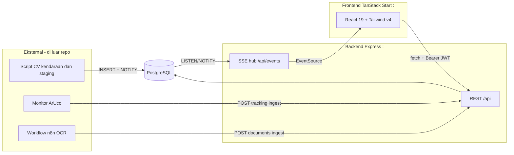
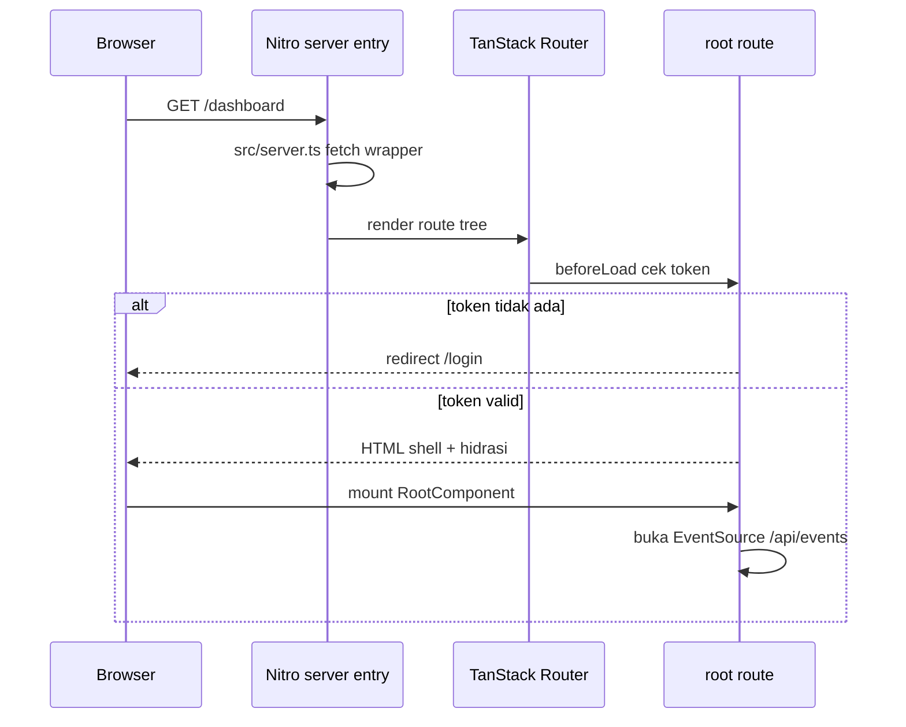
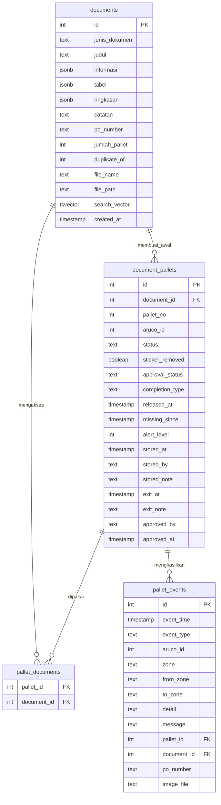
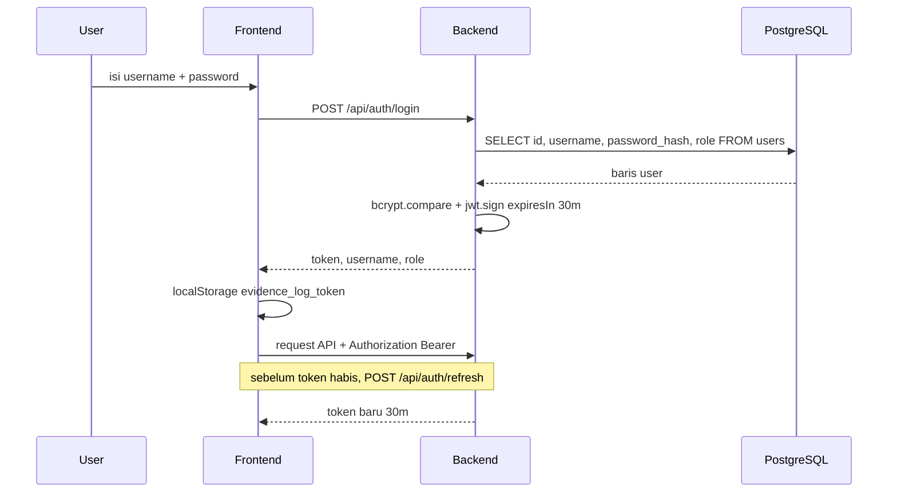
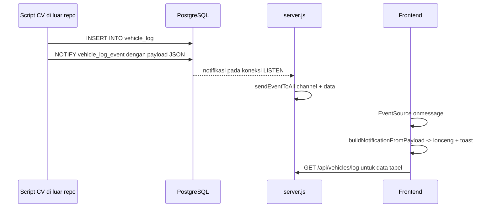
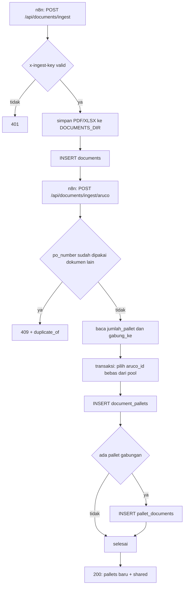
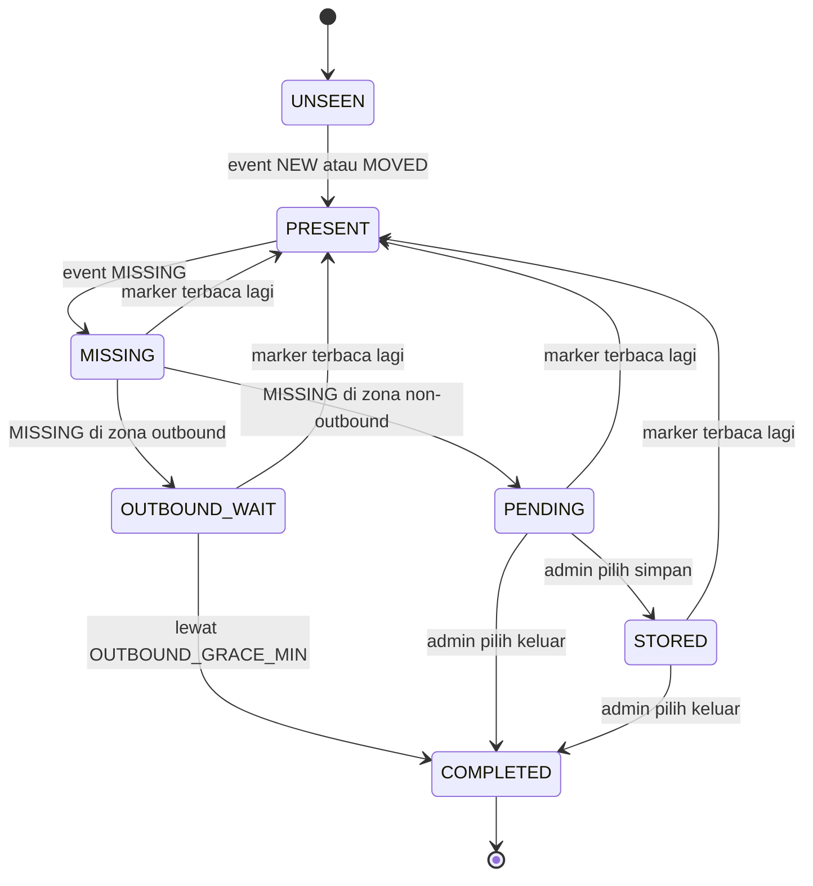
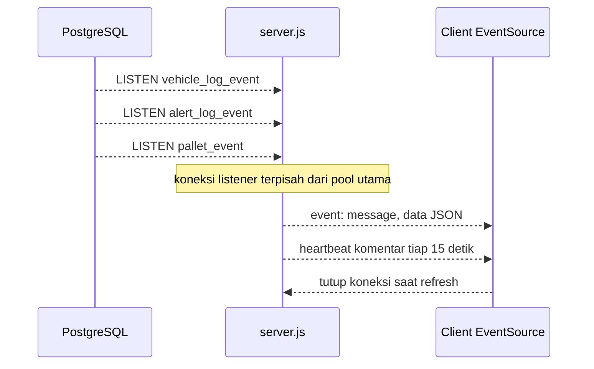
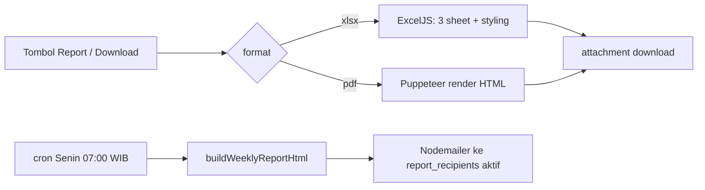

⚠️ PERINGATAN KEAMANAN

Semua URL, port, dan base URL di bawah ini ditulis dengan **placeholder generik** (`{{API_BASE_URL}}`, `:<PORT>`, dll.) untuk dokumentasi. Nilai asli harus diisi melalui environment file (`.env`) dan **tidak boleh di-hardcode** ke dalam kode atau dokumentasi publik.

Jangan menambahkan API key, password, JWT secret, atau URL produksi asli ke dalam file ini.

---
# Arsitektur Evidence Log - Warehouse Intelligence

> Dokumen ini menjelaskan **cara kerja** sistem, bukan cara menjalankan.
> Untuk instalasi dan konfigurasi awal lihat [README.md](../README.md).
> Status verifikasi: seluruh klaim di bawah dicek langsung terhadap kode pada 20 November 2026.
> Dokumen pendamping: [docs/API.md](./API.md).

---

## 1. Gambaran sistem

Evidence Log adalah platform monitoring gudang yang menyatukan empat sumber data berbeda
asal-usulnya. Penting dipahami sejak awal: **repo ini hanya berisi frontend dan backend API**.
Script computer-vision, workflow OCR, dan pengirim notifikasi berjalan di luar repo dan
berkomunikasi lewat database atau endpoint ingest.

| Aktor | Lokasi | Peran |
| :--- | :--- | :--- |
| Script CV kendaraan | di luar repo | Menulis `vehicle_log` + `NOTIFY vehicle_log_event` |
| Script CV staging / CCTV | di luar repo | Menulis `alert_log` + `NOTIFY alert_log_event` |
| Monitor ArUco | di luar repo | `POST /api/tracking/ingest` dengan `x-ingest-key` |
| Workflow n8n | di luar repo | `POST /api/documents/ingest` dan `/documents/ingest/aruco` |
| Frontend | `src/` | SSR React, konsumsi REST + SSE |
| Backend | `backend/` | REST API, SSE hub, export, cron laporan |
| PostgreSQL | infrastruktur | Sumber kebenaran data + kanal `LISTEN`/`NOTIFY` |



Konsekuensi arsitektural yang perlu diingat:

1. Frontend dan backend **tidak berbagi kode**. Tipe data diduplikasi manual di kedua sisi
   (mis. bentuk `vehicle_log` didefinisikan ulang di `dashboard.tsx` dan `logs.vehicles.tsx`).
2. Semua data real-time bergantung pada `NOTIFY` dari luar. Kalau script eksternal berhenti
   mengirim, UI tetap hidup tetapi tidak ada notifikasi baru.
3. Tidak ada ORM. Semua query SQL ditulis manual dengan parameter `$1, $2, ...`.

---

## 2. Stack dan batas versi

| Layer | Teknologi | Catatan versi |
| :--- | :--- | :--- |
| Frontend runtime | React 19.2, React DOM 19.2 | `src/` |
| Frontend framework | TanStack Start 1.167 + TanStack Router 1.168 | file-based routing, SSR |
| Data fetching | TanStack Query 5.83 | retry 1, staleTime 30s |
| Build | Vite 7.3 + `@lovable.dev/vite-tanstack-config` 2.1 | preset membungkus plugin |
| Styling | Tailwind CSS v4 via `@tailwindcss/vite` | konfigurasi aktif di `src/styles.css` |
| UI kit | shadcn/ui gaya new-york + Radix UI + lucide-react | lihat `components.json` |
| Grafik | Recharts 2.15 | hanya dashboard |
| Notifikasi UI | sonner 2.0 | `toast()` |
| Backend runtime | Node.js 22, Express 5.2 | CommonJS |
| Database | PostgreSQL 14+, driver `pg` 8.22 | pool max 20 |
| Auth | jsonwebtoken 9 + bcryptjs 2 | JWT 30 menit + refresh |
| Export | ExcelJS 4.4, Puppeteer 25, PDFKit 0.19 | xlsx / pdf |
| Upload | Multer 2.2 | memory storage |
| Email | Nodemailer 9 | SMTP |
| Scheduler | node-cron 4.6 | Senin 07:00 Asia/Jakarta |
| Deployment | Docker multi-stage, Nitro `node-server` | lihat bagian 11 |

Catatan penting soal Tailwind: `tailwind.config.js` masih ada dengan `darkMode: class`,
tetapi konfigurasi yang benar-benar dipakai ada di `src/styles.css` memakai sintaks
Tailwind v4 (`@import "tailwindcss"`, `@theme inline`, `@custom-variant dark`). Mengubah
`tailwind.config.js` **tidak berpengaruh** pada hasil build.

---

## 3. Struktur folder

```text
evidence-log/
├── src/                        Frontend (TanStack Start)
│   ├── routes/                 Halaman + root layout
│   │   ├── __root.tsx          Shell, guard auth, sidebar, SSE, modal export
│   │   ├── index.tsx           Landing page
│   │   ├── login.tsx           Halaman login
│   │   ├── dashboard.tsx       Dashboard KPI + grafik + feed
│   │   ├── logs.vehicles.tsx   Log kendaraan
│   │   ├── logs.tracking.tsx   Tracking PO / pallet
│   │   ├── logs.documents.tsx  Arsip dokumen + cetak ArUco
│   │   ├── logs.staging.tsx    Deteksi staging legacy
│   │   ├── logs.cameras.tsx    Kejadian kamera + uptime
│   │   └── settings.tsx        User, password, penerima WA, audit log
│   ├── components/             Komponen bersama + 45 komponen ui/
│   ├── lib/                    auth, api-config, evidence, aruco, tema
│   ├── assets/                 Logo + video background
│   ├── router.tsx              QueryClient + createRouter
│   ├── routeTree.gen.ts        GENERATED - jangan diedit
│   ├── server.ts               Wrapper SSR (menangkap error h3)
│   ├── start.ts                Middleware error request-level
│   └── styles.css              Tailwind v4 + token warna
├── backend/
│   ├── server.js               Entry point, guard, SSE hub
│   ├── db.js                   Pool PostgreSQL
│   ├── middleware/auth.js      requireAuth / requireAdmin
│   ├── routes/                 9 router REST
│   ├── utils/                  logger, errors, pagination, mailer, cron
│   ├── migrations/             SQL users + index
│   ├── scripts/create-admin.js Seeder admin pertama
│   └── test/                   4 test node:test
├── public/                     favicon
├── Dockerfile                  Frontend (Nitro)
└── backend/Dockerfile          Backend (Chromium untuk Puppeteer)
```

---

## 4. Urutan boot frontend

1. `vite.config.ts` memakai `defineConfig` dari `@lovable.dev/vite-tanstack-config`.
   Preset itu sudah menyuntikkan plugin TanStack Start, React, Tailwind, tsconfig paths,
   Nitro (target default Cloudflare), alias `@`, dan dedupe React. **Jangan menambah plugin
   yang sama secara manual** - komentar di baris 1-6 file tersebut memperingatkan hal ini.
   Yang dikustom hanya dua hal: `tanstackStart.server.entry = "server"` dan
   `vite.server.allowedHosts = ["<TUNNEL_HOST>"]`.
2. `src/server.ts` menjadi entry SSR. Ia membungkus `@tanstack/react-start/server-entry`
   dan menormalkan respons 500 yang sudah ditelan h3 menjadi halaman error HTML.
3. `src/start.ts` mendaftarkan middleware error pada level request.
4. `src/router.tsx` membuat `QueryClient` dan router dari `routeTree.gen.ts`.
5. `src/routes/__root.tsx` merender `RootShell` (html/head/body), menjalankan guard
   `beforeLoad`, lalu `RootComponent` (layout + SSE).



Build produksi menghasilkan `.output/server/index.mjs` (Nitro preset `node-server`,
lihat `ENV NITRO_PRESET` di `Dockerfile`).

---

## 5. Urutan boot backend

Urutan di `backend/server.js` bersifat fungsional - mengubah urutannya bisa membuka
endpoint tanpa autentikasi. Baca dengan urutan ini:

1. **Validasi env wajib** (`JWT_SECRET`, `DB_HOST`, `DB_PORT`, `DB_NAME`, `DB_USER`,
   `DB_PASSWORD`). Bila kurang, server `process.exit(1)` dengan pesan jelas (baris 7-16).
2. `trust proxy = 1` agar `req.ip` benar di belakang reverse proxy / tunnel.
3. CORS dari `CORS_ORIGIN` (dipisah koma). Default bila kosong: `[disesuaikan lewat CORS_ORIGIN]`.
4. Body parser `express.json()` **dilewati** untuk `/api/tracking/ingest`, karena route itu
   punya parser sendiri dengan limit 10 MB untuk foto base64.
5. ETag dimatikan dan seluruh `/api` diberi header `no-store`.
6. Rate limit global: 400 request per menit per IP.
7. `/api/auth` dipasang **sebelum** guard karena login harus publik.
8. `/api/health` melakukan `SELECT 1` untuk mengecek koneksi database.
9. Guard JWT dipasang untuk semua `/api/*` dengan allowlist publik:
   `/events`, `/documents/ingest`, `/documents/ingest/aruco`, `/tracking/ingest`.
10. Sembilan router dipasang: alerts, vehicles, notifications, wa-recipients,
    report-recipients, audit-log, export, documents, tracking.
11. **SSE hub**: `listenerPool` (koneksi terpisah dari pool utama) menjalankan
    `LISTEN vehicle_log_event`, lalu `alert_log_event`, lalu `pallet_event` **secara
    berurutan** - `pg` melarang dua query bersamaan pada satu koneksi.
12. Global error handler menerjemahkan error Multer (`LIMIT_FILE_SIZE` -> 413,
    `LIMIT_FILE_COUNT` -> 413) agar frontend selalu menerima JSON.
13. Tuning keep-alive: `keepAliveTimeout 65s`, `headersTimeout 66s`,
    `requestTimeout 0`, `server.timeout 0`. Ini bukan kosmetik - tanpanya koneksi SSE
    dan request biasa saling mengganggu (lihat komentar baris 210-219).

`backend/db.js` mengekspor satu `Pool` bersama: maksimal 20 koneksi,
`idleTimeoutMillis 30s`, `connectionTimeoutMillis 5s`, `statement_timeout 10s`.
Semua router mengimpor pool ini, jadi query yang lebih dari 10 detik akan diputus
oleh PostgreSQL.
---

## 6. Peta modul frontend

Semua halaman adalah file di `src/routes/` yang didaftarkan otomatis oleh TanStack Router
(file-based routing). `routeTree.gen.ts` dihasilkan dari nama file - jangan diedit manual.

| File | Baris | Tanggung jawab | Endpoint utama |
| :--- | ---: | :--- | :--- |
| `routes/__root.tsx` | 1105 | Shell HTML, guard auth, sidebar, breadcrumb, SSE, notifikasi, modal export, modal sesi berakhir | `/api/events`, `/api/export/*` |
| `routes/index.tsx` | 264 | Landing page video + tombol masuk | - |
| `routes/login.tsx` | 163 | Form login, redirect bila sudah auth | `/api/auth/login` |
| `routes/dashboard.tsx` | 2090 | KPI, grafik per jam, feed aktivitas, ringkasan tracking | `/vehicles/log`, `/tracking/events`, `/tracking/pos`, `/tracking/summary`, `/alerts`, `/vehicles/stats/hourly`, `/alerts/stats/camera-status` |
| `routes/logs.vehicles.tsx` | 1063 | Log kendaraan, filter, cari plat, flag false positive, riwayat siklus | `/vehicles/log`, `/vehicles/log/:id/flag`, `/vehicles/history/:vehicle_id` |
| `routes/logs.tracking.tsx` | 1929 | Daftar PO/pallet, detail event, ACC hilang, konfirmasi simpan/keluar | `/tracking/pos`, `/tracking/pos/:id/pallets`, `/tracking/pallets/:id/store|exit`, `/tracking/events` |
| `routes/logs.documents.tsx` | 1312 | Arsip dokumen OCR, detail, unduh file, cetak stiker ArUco A4, gabung pallet | `/documents`, `/documents/:id`, `/documents/:id/file`, `/documents/pool`, `/documents/pallets/aktif` |
| `routes/logs.staging.tsx` | 624 | Deteksi staging legacy 3 hari + prediksi risiko | `/alerts` |
| `routes/logs.cameras.tsx` | 602 | Kejadian kamera offline + uptime per kamera | `/alerts?class_name=KAMERA OFFLINE`, `/alerts/stats/camera-uptime` |
| `routes/settings.tsx` | 1306 | Manajemen user (admin), ganti password, penerima WA, audit log | `/auth/users`, `/auth/register`, `/auth/change-password`, `/wa-recipients`, `/audit-log` |

Komponen lintas halaman:

| File | Dipakai oleh | Fungsi |
| :--- | :--- | :--- |
| `components/DateRangeFilter.tsx` | dashboard, vehicles, staging, cameras | Input rentang tanggal dengan mode rentang terbuka |
| `components/VehicleHistoryModal.tsx` | dashboard, vehicles | Menampilkan semua event satu `vehicle_id` |
| `components/EscalationRiskCard.tsx` | dashboard | Kartu prediksi eskalasi |
| `components/Toast.tsx` | - | Komponen toast lokal (mayoritas halaman memakai `sonner`) |

Library bersama di `src/lib/`:

| File | Fungsi |
| :--- | :--- |
| `api-config.ts` | `API_BASE_URL` dari `VITE_API_BASE_URL`, fallback `{{API_BASE_URL}}` |
| `auth.ts` | Token localStorage, decode JWT, `authFetch`, `refreshToken`, `downloadFile`, `isAdmin` |
| `evidence.ts` | Formatter tanggal, generator deskripsi otomatis, klasifikasi muatan/aktivitas |
| `aruco.ts` | Tabel bit DICT_4X4 -> matriks 6x6 -> SVG marker (pool pallet 1-100) |
| `theme-provider.tsx` | Tema dark/light/system, key `vite-ui-theme` |
| `theme-tokens.ts` | Satu palet warna untuk halaman Logs & Settings |
| `error-capture.ts`, `error-page.ts` | Penangkap error SSR + halaman error statis |

### Pola konsisten di halaman Logs

1. Data diambil dengan `useQuery` dan `queryKey` yang selalu memuat `page`, `startDate`,
   `endDate` agar cache otomatis terpisah per filter.
2. `meta: { showErrorToast: true, errorLabel: "..." }` membuat kegagalan fetch memunculkan
   toast global dari `src/router.tsx`.
3. Respons dinormalisasi lewat helper longgar (`parseAlertResponse`, `parseVehicleResponse`)
   yang menerima `{ data, total }` **atau** array mentah.
4. Dark mode dideteksi lewat `MutationObserver` pada atribut `class` di `<html>`,
   lalu warna diambil dari `getLogsPageColors(isDark)`.
5. Semua HTTP lewat `authFetch()`, yang otomatis menambahkan Bearer dan menghapus token
   saat menerima 401.

---

## 7. Peta modul backend

| File | Baris | Tanggung jawab |
| :--- | ---: | :--- |
| `server.js` | 219 | Boot, CORS, rate limit, guard JWT, SSE hub, error handler |
| `db.js` | 22 | Pool PostgreSQL bersama |
| `middleware/auth.js` | 55 | `requireAuth`, `requireAdmin`, `verifyTokenString` |
| `routes/auth.js` | 229 | Login (rate limit 10/15 menit per IP), CRUD user, ganti password, refresh token |
| `routes/vehicles.js` | 343 | Log kendaraan (paginasi per grup), riwayat, flag, statistik, export PDF |
| `routes/alerts.js` | 582 | Listing `alert_log`, statistik kamera, uptime, risiko eskalasi, export PDF |
| `routes/tracking.js` | 860 | Ingest pallet, state machine, ACC, cron alert hilang, outbound completion |
| `routes/documents.js` | 796 | Ingest OCR + alokasi ArUco, upload ke n8n, daftar/detail, gabung, hapus |
| `routes/export.js` | 1000 | Laporan Excel multi-sheet + PDF via Puppeteer |
| `routes/wa-recipients.js` | 157 | CRUD penerima WhatsApp (tulis: admin) |
| `routes/report-recipients.js` | 134 | CRUD penerima email + `test-send` |
| `routes/audit-log.js` | 39 | Riwayat aksi admin |
| `routes/notifications.js` | 16 | Stub: baca tabel `notifications` |
| `utils/scheduledReports.js` | 344 | Cron laporan mingguan + builder HTML email |
| `utils/validateDateRange.js` | 76 | Validasi `YYYY-MM-DD` + batas akhir hari `23:59:59.999999` |
| `utils/pagination.js` | 6 | `clampLimit` (default 20, maks 100) |
| `utils/auditLog.js` | 27 | `recordAudit` fire-and-forget |
| `utils/logger.js` | 16 | Log bertimestamp ISO |
| `utils/errors.js` | 12 | `sendServerError` (pesan detail hanya saat non-production) |
| `utils/mailer.js` | 33 | Transporter SMTP + `sendEmail` |
| `convertImages.js` | 150 | Script utilitas konversi gambar (tidak dipanggil server) |

Dua modul berisi logika paling rawan dan paling sering berubah:

- `routes/tracking.js` - state machine pallet, tiga timer latar (`checkMissingAlerts`,
  `checkOutboundCompletions`), dan `pg_notify` untuk lonceng notifikasi.
- `routes/documents.js` - alokasi nomor ArUco dari pool, transaksi gabung pallet, dan
  penanganan PO duplikat.

---

## 8. Model data dan relasi

Tidak ada file skema lengkap di repo. `backend/migrations/` hanya berisi tabel `users`
(zaman awal) dan file index. Skema di bawah direkonstruksi dari kolom yang dipakai query.



Tabel lain yang dipakai route tetapi tidak berelasi langsung dengan pallet:

| Tabel | Kolom kunci | Dipakai oleh |
| :--- | :--- | :--- |
| `users` | `id, username, password_hash, role, created_at` | `routes/auth.js` |
| `audit_log` | `actor_id, actor_username, action, target_type, target_label, details, created_at` | `utils/auditLog.js`, `routes/audit-log.js` |
| `vehicle_log` | `timestamp, jenis_kendaraan, warna, confidence, bbox_*, gambar_base64, kamera_nama, status_muatan, status_aktivitas, track_id, vehicle_id, plat_nomor, plat_confidence, jenis_kejadian, is_false_positive` | `routes/vehicles.js` |
| `alert_log` | `camera, class_name, first_detected, duration, alert_level, file_name, foto_base64, alert_sent_1..3, predicted_risk` | `routes/alerts.js` |
| `wa_recipients` | `nama, nomor, aktif, akses_staging, akses_laporan_harian, akses_laporan_mingguan, akses_chatbot` | `routes/wa-recipients.js` |
| `report_recipients` | `nama, email, aktif` | `routes/report-recipients.js` |
| `notifications` | tidak diketahui (route memakai `SELECT *`) | `routes/notifications.js` |
| `attendance_event`, `employees` | hanya punya index di `add_indexes.sql` | tidak ada route aktif |

### Catatan penting tentang data

1. `pallet_documents` adalah relasi many-to-many: satu pallet fisik bisa memuat lebih dari
   satu PO (istilahnya "gabung"). Karena itu label PO di UI sering berbentuk `PO-A + PO-B`.
2. `document_pallets.document_id` tetap menyimpan "pembuat awal" pallet, sedangkan
   keanggotaan PO yang sebenarnya dibaca dari `pallet_documents`. Query yang hanya memakai
   `document_id` akan salah untuk pallet gabungan - itu sebabnya banyak query memakai
   `poLabelSql()` atau CTE rekursif `GRUP_CTE`.
3. `pallet_events` memiliki unique constraint pada `(event_time, event_type, aruco_id, zone)`.
   Ingest memakai `ON CONFLICT DO NOTHING`, sehingga pengiriman ulang dari monitor tidak
   menggandakan data.
4. `vehicle_log.gambar_base64` menyimpan foto **di dalam database**, sedangkan foto tracking
   disimpan sebagai file di `TRACKING_DIR`. Ini asimetri yang disengaja (warisan desain lama)
   tetapi berdampak besar pada ukuran tabel.
5. `alert_log.duration` satuan detik. Route listing memfilter `duration >= 259200` (3 hari)
   agar hanya barang yang benar-benar mengendap yang tampil.
---

## 9. Alur utama end-to-end

### 9.1 Login, sesi, dan silent refresh



Detail yang mudah terlewat:

- Rate limit login bersifat **per IP di memori proses**, 10 percobaan per 15 menit
  (`routes/auth.js` baris 10-36). Restart server mereset hitungan.
- Perbandingan password selalu dijalankan, bahkan saat user tidak ditemukan, memakai hash
  dummy. Tujuannya menyamakan waktu respons agar tidak bisa dipakai menebak username.
- Token lama yang diterbitkan sebelum fitur role ada **tidak punya** field `role`.
  `getCurrentUser()` di `src/lib/auth.ts` menganggap token seperti itu sebagai `admin`
  agar user lama tidak mendadak kehilangan akses.
- `refreshToken()` dipanggil diam-diam dari `__root.tsx` berdasarkan sisa waktu token
  (`getTokenSecondsRemaining`). Kalau gagal, UI menampilkan modal "Sesi Berakhir",
  bukan redirect paksa di tengah pekerjaan.

### 9.2 Kendaraan: script CV -> database -> SSE -> UI



Satu kendaraan fisik biasanya tersimpan sebagai **beberapa baris** `vehicle_log` yang
terhubung lewat `vehicle_id` (event `MASUK`, event `KELUAR`, kadang update status muatan).
Pengelompokan menjadi satu kartu dilakukan **dua kali**:

1. Di SQL (`routes/vehicles.js` baris 68-100) memakai `COALESCE(vehicle_id, single-id)`,
   sehingga paginasi menghitung kendaraan, bukan baris.
2. Di React (`dashboard.tsx` baris 447-476) memakai `useMemo` dengan kunci yang sama.

Keduanya harus diubah bersamaan. Kalau hanya salah satu yang diubah, jumlah kartu di
halaman dan jumlah `total` dari API akan berbeda.

### 9.3 Ingest dokumen OCR dan alokasi marker ArUco



Aturan pool marker (`routes/documents.js` baris 213-223):

- `POOL_MIN = 1` (ID 0 dipakai marker kamera), `POOL_MAX` = `MARKER_POOL_MAX` atau 999.
- Nomor dialokasikan dari yang **terkecil dan bebas**, sehingga nomor tidak menumpuk acak.
- Slot dianggap terpakai bila pallet `ACTIVE`, **atau** `RELEASED` tetapi `sticker_removed`
  masih false. Artinya nomor baru kembali ke pool hanya setelah stiker fisik dicopot dan
  dikonfirmasi lewat `POST /api/documents/pallets/:palletId/sticker-removed`.
- `MAX_PALLET_PER_PO` membatasi jumlah pallet per PO (`maxPalletPerPo()`).

Alur upload manual dari dashboard berbeda: browser mengirim ke `POST /api/documents/upload`,
lalu **backend** yang meneruskan file ke `N8N_WEBHOOK_URL`. Webhook n8n tidak perlu dibuka
ke publik. Respons yang dikembalikan ke browser adalah `202 Accepted`, bukan hasil OCR.

### 9.4 State machine pallet

Ini bagian paling penting untuk dipahami sebelum menyentuh `routes/tracking.js`.



Arti tiap state di UI (`logs.tracking.tsx`):

| State | Sumber | Arti |
| :--- | :--- | :--- |
| `UNSEEN` | belum ada event | Pallet terdaftar tetapi marker belum pernah terbaca |
| `PRESENT` | event terakhir bukan MISSING | Terakhir terlihat di suatu zona |
| `MISSING` | event terakhir MISSING | Hilang, belum perlu ACC (mis. baru hilang di outbound) |
| `PENDING` | `approval_status = PENDING` | Hilang di zona non-outbound, menunggu keputusan admin |
| `STORED` | `stored_at` terisi | Barang disimpan di inventaris; pallet tetap aktif dan tetap dilacak |
| `COMPLETED` | `status = RELEASED` | Selesai, baik otomatis (outbound) maupun manual |

Logika di `POST /api/tracking/ingest` (baris 172-205):

1. Event `MISSING` di zona outbound -> isi `missing_since`, **jangan** ubah status.
2. Event `MISSING` di zona lain -> `approval_status = PENDING`, reset `alert_level = 0`.
3. Event apa pun selain MISSING -> bersihkan `approval_status`, `missing_since`,
   `alert_level`, dan status inventaris. Ini yang membuat pallet bisa "muncul kembali".

Dua timer latar menggerakkan state tanpa campur tangan user:

- `checkMissingAlerts()` tiap `MISSING_ALERT_CHECK_MIN` (default 5 menit). Setiap ambang di
  `MISSING_ALERT_HOURS` (default `3,6`) yang terlewati menghasilkan satu event
  `MISSING_ALERT` + notifikasi lonceng. Tidak dikirim ulang untuk level yang sama.
- `checkOutboundCompletions()` menandai `RELEASED` pallet yang hilang dari zona outbound
  lebih lama dari `OUTBOUND_GRACE_MIN` (default 1440 menit = 24 jam) dan tidak terbaca lagi.

Keduanya bisa dimatikan dengan `TRACKING_ALERTS=off` (khusus `checkMissingAlerts`).

### 9.5 Notifikasi real-time (SSE hub)



Tiga kanal yang didengarkan di `server.js` baris 145-185: `vehicle_log_event`,
`alert_log_event`, `pallet_event`. Backend **hanya mengirim** `pallet_event`
(dari `routes/tracking.js` via `pg_notify`). Dua kanal lain dikirim oleh sistem eksternal.

`src/routes/__root.tsx` memetakan payload mentah menjadi notifikasi ber-`kind`
(`vehicle`, `alert`, `camera`, `tracking`) lewat `buildNotificationFromPayload`.
`MOVED_POS` tidak dikirim sebagai notifikasi. `MISSING_ALERT` dikirim oleh `checkMissingAlerts()`, tetapi tidak punya cabang khusus di `buildNotificationFromPayload`, sehingga tampil sebagai notifikasi generik "Update baru".

### 9.6 Export dan laporan terjadwal



- `GET /api/export/daily|weekly|monthly|full-report` menerima `format=xlsx|pdf`.
- Excel memakai `ExcelJS` dengan palet dan format khusus (`formatPremiumLogSheet`).
- PDF dibuat dengan `Puppeteer` merender HTML string. Karena itu image backend Docker
  memasang Chromium (lihat `backend/Dockerfile`).
- Cron mingguan didaftarkan oleh `startScheduledReports()` (`utils/scheduledReports.js`
  baris 332-344) dengan ekspresi `0 7 * * 1` dan timezone `Asia/Jakarta`.
- `POST /api/report-recipients/test-send` menjalankan laporan yang sama tanpa menunggu Senin.
- Laporan mingguan merangkum 7 hari terakhir: deteksi box, kendaraan per jenis, 200 riwayat
  kendaraan terbaru, uptime kamera, dan staging yang sudah lebih dari 3 hari.
---

## 10. Konvensi dan aturan kontribusi

### Backend

1. Modul memakai CommonJS (`require` / `module.exports`), bukan ESM.
2. Router baru wajib didaftarkan di `server.js`. Kalau endpoint dipanggil mesin (bukan
   browser), tambahkan ke allowlist `PUBLIC_API_PATHS` dan lindungi dengan `x-ingest-key`.
3. Semua query memakai parameter posisional (`$1`, `$2`) - jangan interpolasi string.
4. Pola error yang dipakai konsisten:
   ```js
   } catch (err) {
     sendServerError(res, err, "GET /api/contoh");
   }
   ```
   Jangan mengirim `err.message` mentah ke client pada production.
5. Validasi tanggal memakai `validateDateRange()` dan batas akhir hari memakai
   `endOfDayBoundary()` - jangan menulis `end_date + " 23:59:59"` manual, karena baris
   dengan pecahan mikrodetik akan terlewat.
6. Batasi `limit` dengan `clampLimit(rawLimit, { defaultLimit, maxLimit })`.
7. Aksi yang mengubah data sensitif (user, penerima, hapus dokumen) wajib memanggil
   `recordAudit()`. Fungsi ini fire-and-forget, jadi jangan `await` sebelum response.
8. Operasi multi-tabel (alokasi pallet, gabung, hapus) harus berada dalam satu transaksi
   (`BEGIN` / `COMMIT` / `ROLLBACK`) memakai satu client dari pool.

### Frontend

1. Halaman baru = file di `src/routes/`; `routeTree.gen.ts` dibuat otomatis saat dev/build.
2. Semua request lewat `authFetch()` dari `@/lib/auth`, bukan `fetch` mentah.
3. Query wajib punya `meta.errorLabel` agar toast error berbunyi informatif.
4. Warna: halaman Logs dan Settings **harus** memakai `getLogsPageColors()` /
   `getSettingsPageColors()` dari `@/lib/theme-tokens`. Dashboard dan `__root` memakai
   palet arbitrary Tailwind yang didokumentasikan di `__root.tsx` baris 45-60
   (`#13130e` page, `#1a1a14` card, `#22221a` hover, `#2e2e25` border). Jangan membuat
   shade hitam baru.
5. Format tanggal dan deskripsi otomatis memakai `@/lib/evidence`, jangan duplikasi
   `Intl.DateTimeFormat` di komponen.
6. Ikon dari `lucide-react`; komponen UI dari `src/components/ui/` (shadcn).

### Gaya komentar

Komentar di repo ini ditulis dalam Bahasa Indonesia dan menjelaskan **alasan** sebuah
keputusan, sering merujuk bug yang pernah terjadi (contoh jelas di `routes/auth.js` baris
14-17 dan `routes/vehicles.js` baris 14-28). Pertahankan gaya ini: komentar yang menjelaskan
"kenapa" jauh lebih berguna di sini daripada komentar yang mengulang "apa".

---

## 11. Konfigurasi environment

### Frontend - `.env` di root

| Variabel | Wajib | Default | Keterangan |
| :--- | :--- | :--- | :--- |
| `VITE_API_BASE_URL` | ya (produksi) | `{{API_BASE_URL}}` | Alamat backend, dibaca `src/lib/api-config.ts` |

### Backend - `backend/.env`

| Variabel | Wajib | Default | Keterangan |
| :--- | :--- | :--- | :--- |
| `DB_HOST`, `DB_PORT`, `DB_NAME`, `DB_USER`, `DB_PASSWORD` | ya | - | Koneksi PostgreSQL |
| `JWT_SECRET` | ya | - | Kunci tanda tangan JWT |
| `PORT` | tidak | `5000` | Port HTTP |
| `NODE_ENV` | tidak | - | Mengatur detail pesan error |
| `CORS_ORIGIN` | tidak | `[disesuaikan lewat CORS_ORIGIN]` | Daftar origin dipisah koma |
| `DOCUMENTS_DIR` | tidak | `backend/documents-files` | Penyimpanan file dokumen |
| `TRACKING_DIR` | tidak | `backend/tracking-images` | Penyimpanan foto event pallet |
| `DOCUMENTS_INGEST_KEY` | ya untuk ingest | - | Kunci `x-ingest-key` dokumen |
| `TRACKING_INGEST_KEY` | ya untuk ingest | fallback ke `DOCUMENTS_INGEST_KEY` | Kunci `x-ingest-key` tracking |
| `N8N_WEBHOOK_URL` | ya untuk upload | - | Tujuan upload manual |
| `N8N_UPLOAD_KEY` | tidak | - | Header `x-upload-key` ke n8n |
| `TRACKING_TZ` | tidak | `Asia/Jakarta` | Zona waktu event tracking |
| `OUTBOUND_ZONES` | tidak | `outbound,outbund` | Nama zona dianggap outbound |
| `OUTBOUND_GRACE_MIN` | tidak | `1440` | Jeda sebelum pallet outbound selesai |
| `MARKER_POOL_MAX` | tidak | `999` | Batas atas ID marker (maks 999) |
| `MAX_PALLET_PER_PO` | tidak | `999` | Batas pallet per PO |
| `MISSING_ALERT_HOURS` | tidak | `3,6` | Ambang alert pallet hilang |
| `MISSING_ALERT_CHECK_MIN` | tidak | `5` | Interval pengecekan alert |
| `TRACKING_ALERTS` | tidak | aktif | `off` mematikan pengecekan alert |
| `CAMERA_SOURCE` | tidak | `alert_log` | `pallet_events` bila kejadian kamera pindah sumber |
| `SMTP_HOST`, `SMTP_PORT`, `SMTP_USER`, `SMTP_PASS` | untuk email | `smtp.gmail.com:587` | Nodemailer |

Catatan: `backend/.env.example` yang ada di repo masih berisi placeholder lama
(`SNAPSHOT_DIR`, `PYTHON_EXECUTABLE`, `POSE_DB_PATH`) yang tidak dipakai kode saat ini.
Tabel di atas adalah daftar yang benar-benar dibaca.

---

## 12. Deployment

### Frontend

```bash
docker build --build-arg VITE_API_BASE_URL={{BACKEND_URL}} -t evidence-log-frontend .
docker run -d -p <PORT_FRONTEND>:<PORT_FRONTEND> --name evidence-frontend evidence-log-frontend
```

Dockerfile dua tahap: builder `node:22-bookworm-slim` menjalankan `npm ci --legacy-peer-deps`
lalu `npm run build` dengan `NITRO_PRESET=node-server`; image akhir hanya menyalin `.output`
dan menjalankan `node .output/server/index.mjs`. Artinya `VITE_API_BASE_URL` **tertanam saat
build**, bukan saat runtime. Mengganti alamat backend memerlukan build ulang.

### Backend

```bash
docker build -t evidence-log-backend ./backend
docker run -d -p <PORT_BACKEND>:<PORT_BACKEND> --env-file backend/.env --name evidence-backend evidence-log-backend
```

Image backend memasang Chromium + font + `libcairo`/`libpango` agar Puppeteer bisa
membuat PDF. `PUPPETEER_SKIP_DOWNLOAD=true` dan `PUPPETEER_EXECUTABLE_PATH=/usr/bin/chromium`,
`TZ=Asia/Jakarta`.

### Akses dari jaringan luar (tunnel)

`vite.config.ts` mengizinkan host `<TUNNEL_HOST>`. Alur yang dipakai tim:
1. Jalankan backend di port <PORT_BACKEND>.
2. `cloudflared tunnel --url <LOCAL_HOST_PORT>`, catat URL yang muncul.
3. Isi URL itu di `.env` frontend sebagai `VITE_API_BASE_URL`, lalu `npm run dev:tunnel`.
4. Daftarkan juga origin tunnel di `CORS_ORIGIN` backend.

---

## 13. Temuan dan utang teknis

Temuan berikut adalah hasil pembacaan kode, bukan asumsi. Semuanya sengaja **belum diubah**
agar keputusan tetap di tangan pemilik sistem.

| # | Temuan | Lokasi | Dampak |
| :--- | :--- | :--- | :--- |
| 1 | `backend/.env` ikut ter-commit (1,3 KB) | repo | Kredensial DB/JWT berisiko bocor; sebaiknya di-rotate lalu dihapus dari git |
| 2 | Default `CORS_ORIGIN` adalah `[disesuaikan lewat CORS_ORIGIN]`, bukan 3000 | `server.js` baris 24 | CORS gagal bila env tidak diisi saat dev |
| 3 | Foto kendaraan disimpan sebagai base64 di DB | `vehicle_log.gambar_base64` | Tabel membengkak, query melambat |
| 4 | Jumlah kamera hardcoded 22 | `dashboard.tsx` baris 56 | Perlu ubah kode saat kamera bertambah |
| 5 | Breadcrumb dirender di `__root` dan diulang per halaman | `__root.tsx` + `dashboard.tsx` baris 566 | Duplikasi markup dan risiko tampilan ganda |
| 6 | Pengelompokan kendaraan ada di SQL dan di JS | `vehicles.js` dan `dashboard.tsx` | Rawan tidak sinkron |
| 7 | Import tidak terpakai | `utils/errors.js` baris 1 | Kebersihan kode |
| 8 | Dua domain data hidup berdampingan | `alert_log` (legacy) vs `pallet_events` | Halaman Staging/Kamera memakai model lama |
| 9 | `notifications.js` hanya stub | `routes/notifications.js` | Fitur belum selesai, tabel `notifications` tidak dikelola |
| 10 | `migrations/` tidak lengkap | `backend/migrations/` | Setup database baru dari repo tidak bisa |
| 11 | API penerima email tidak dipakai UI | `report-recipients.js` vs `settings.tsx` | Pengaturan penerima laporan hanya bisa via API |
| 12 | `backend/.env.example` memuat variabel usang | `backend/.env.example` | Menyesatkan saat setup baru |

---

## 14. Urutan belajar yang disarankan

Bagi pembaca baru, urutan ini paling efisien karena setiap langkah hanya bergantung pada
langkah sebelumnya:

1. `README.md`, `package.json`, `.env.example` (root dan backend) - pahami stack dan konfigurasi.
2. `backend/server.js` -> `backend/db.js` -> `backend/middleware/auth.js` -> `backend/routes/auth.js`
   - fondasi, guard, dan keamanan.
3. `src/lib/auth.ts` -> `src/routes/__root.tsx` - alur login, guard route, layout, SSE.
4. `backend/routes/vehicles.js` + `src/routes/logs.vehicles.tsx` - contoh fitur end-to-end paling bersih.
5. `backend/routes/tracking.js` + `src/routes/logs.tracking.tsx` - state machine pallet (paling kompleks).
6. `backend/routes/documents.js` + `src/routes/logs.documents.tsx` + `src/lib/aruco.ts`
   - ingest OCR, pool marker, cetak stiker.
7. `backend/routes/export.js` + `backend/utils/scheduledReports.js` - ExcelJS, Puppeteer, email.
8. `backend/routes/alerts.js`, `src/routes/settings.tsx`, komponen `ui/` - sisanya.

Selama membaca, biasakan membuka dokumen [docs/API.md](./API.md) berdampingan agar tahu
kontrak data yang mengalir di antara kedua aplikasi.


